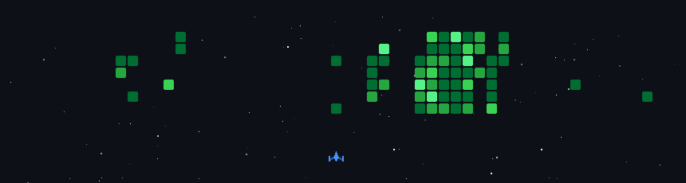

  

  

  
  
  

  

## About Me

- Computer Engineering Student
- AI & Machine Learning Enthusiast
- Full Stack Developer
- Android Developer
- Passionate about solving real-world problems with technology

 

  

## Tech Stack

  

  

## GitHub Analytics

  

  

<picture>
  <source
    media="(prefers-color-scheme: dark)"
    srcset="https://raw.githubusercontent.com/ayushjoshi-dehub/ayushjoshi-dehub/output/github-contribution-grid-snake-dark.svg">
  
</picture>

<!-- 

  

 -->

  

  

## Connect With Me

  
  
  

  

  

